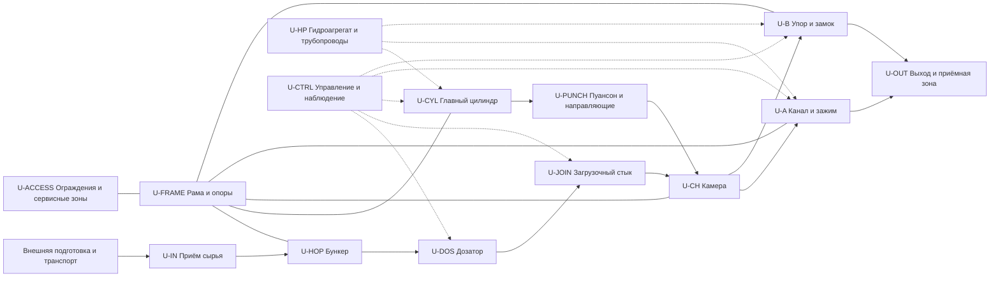
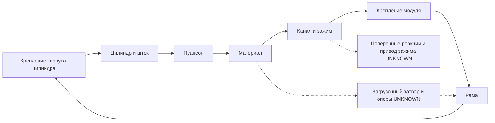
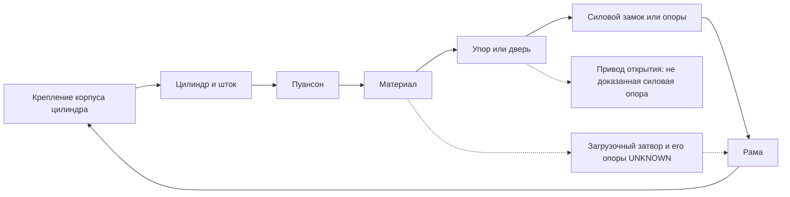

# REV — постановка первой параметрической компоновки всего пресса A/B

DRAFT / READY_FOR_INDEPENDENT_REVIEW. Задача T-r4-layout-01; автор R4 / Codex / r4-linked-20261111; 2026-11-11 UTC. База main c00c75dda08889c3e19169476051b3e6980be721, после PR #33 и принятия отдельного claim через PR #34. Версии входов и SHA-256 — [input_manifest.json](input_manifest.json); собственный входной аудит — [input_audit.md](input_audit.md).

Это задание на будущую собственную компоновку всего REV, не готовая CAD-модель. Оба варианта сохраняются: A — канал с зажимом; B — закрытая камера с открываемым упором и выталкиванием главным пуансоном. Ни один вариант, тип дозатора, исполнение цилиндра или силового замыкания не выбран. Все реальные размеры, ходы, положения, нагрузки, свойства сырья, допуски и численные критерии — **UNKNOWN**. Числа synthetic-сцен не используются для размеров REV. ТЗ, архитектура и G1 не утверждаются; пробы и испытания NOT_RUN.

## Граница и цель будущей модели

Компоновка должна охватить путь от согласованной передачи подготовленного сырья на пресс до передачи изделия/остатков в приёмную зону, а также необходимые силовые, энергетические, управляющие, монтажные и сервисные интерфейсы. Предварительный ориентир передачи по OP-REV-07 — после существующих дробления и просева. По OP-REV-09 проверка остаточного металла и иных включений предварительно относится к существующей линии; методы, пороги, фактическая эффективность и действия при отклонениях UNKNOWN. По OP-REV-10 возможную допподготовку предварительно рассматривают на существующей линии, только если исследование установит её необходимость; необходимость, состав операций, оборудование и свободная мощность UNKNOWN. Предварительная граница по OP-REV-11 — выход пресса. Точные места и рабочие интерфейсы ещё не согласованы; транспорт от просева, буфер, последующие транспорт/накопление, их сторона поставки и ответственность UNKNOWN (OP-REV-08). Сортировка, металлосепарация, дробление и просев — сообщения оператора, не подтверждение эффективности и свойств потока; возможность сушки не подтверждена. Источник уточнений — process/supply_boundary_options.md на базе c00c75dda08889c3e19169476051b3e6980be721 и записи OP-REV-07…11 в трекере. Пеллетное производство не задаёт автоматически параметры REV.

Результат первой модели — собственные параметрические габариты, взаимное положение и связи узлов, фазовые положения/траектории и перечень проверенных/непроверенных интерфейсов. Модель должна показывать весь пресс, включая гидроагрегат, коммуникации, управление, ограждения и доступы как отдельные проектируемые зоны. Она не доказывает формование древесины, физическое удержание столба, разгрузку упора, работоспособность защит, ресурс или изготовимость.

Идентификаторы U/I/D/V ниже — локальные адреса узлов, интерфейсов, требуемых данных и проверок, а не зарегистрированные численные параметры изделия. Перед будущим инженерным использованием значений создать записи в params/registry.yaml с единицами, происхождением, областью, ревизией, неопределённостью и допуском; сейчас реестр не изменяется. UNKNOWN не заменять нулём, типовым размером или чужим изделием.

## Документальные основания и пределы знания

Все пути S относятся к базе c00c75dda08889c3e19169476051b3e6980be721 из manifest; названные разделы задают область чтения и использования, а не независимую проверку исходных PDF.

| Источник | Что можно использовать для постановки | Что он не устанавливает |
|---|---|---|
| S-CON: concepts/press_functional_alternatives.md, разделы A/B, стык и силовой контур | Собственные качественные альтернативы всего пресса, независимые дозатор/затвор/пуансон, условные пути реакции | Геометрию, нагрузки, работоспособность или выбор схемы |
| S-CYCLE: controls/press_variant_state_tables.md, таблицы A/B и общие правила | Перечень фаз и требуемых разрешений; A-OUT связан с A-PRESS, B-UNLOAD отделён от B-OPEN | Реальные времена, сигналы, удержание или физическую разгрузку |
| S-REQ: requirements/system_requirements.md и verification_matrix.md, REQ/VAL-REV-05/06/07/09/11/12/13/14/15/16/17/19/22 | Проект требуемых функций, интерфейсов и будущих доказательств | Утверждённое ТЗ или завершённые VAL |
| S-FEED: process/feedstock.md, OP-REV и UNKNOWN | Сообщённое происхождение потока и необходимость его паспортизации | Измеренные свойства/однородность/допустимые примеси и пригодность сырья |
| S-INPUT: verification/engineering_input_map.md | Зависимость будущих нагрузок и привода от партии, дозы, хода, разгрузки и выдачи; разные измерительные границы | Силу цилиндра по одному давлению, нагрузки на раму или характеристики продукта |
| S-SRC: sources/index.md, паспорта BP500/ARS/E55/TH200 | Наличие документов, типы схем и адреса для будущей проверки: BP500 PDF 2–4; ARS узлы/схемы; E55 компоновка/монтаж; TH200 установочный лист | Конструкторские входы REV; размеры и характеристики других машин не переносятся |
| S-COTS: drives/cots_catalog.yaml и params/registry.yaml | Фиксацию отсутствия выбранных покупных узлов и численных проектных входов | APPROVED_FOR_LAYOUT-компоненты, проверенные посадки или нагрузки |
| S-MODEL: models/first_digital_model_brief.md; verification/r4_linked_scene_r1_disposition.md; verification/r5_linked_scene_fix_recheck/review.md | Различие контакта, связи, коллизии, неизвестности, lifecycle и ограниченную проверенную область synthetic AABB на 8896d709 | Геометрию всего REV, вращательные/деформируемые движения, прочность, безопасность и физику реального пресса |

Четыре PDF в этой задаче заново не обмерялись. Страничные указатели S-SRC — навигация для будущей адресной проверки исполнителями; не доказательство пригодности узла. BP500 — функциональный ориентир, ARS/E55/TH200 — источники разных решений, не размерные прототипы собственного REV. BP500-ANALOG не используется.

## Состав узлов и интерфейсы целого пресса

Схема показывает функции и связи, не форму, масштаб или размещение. Области движения, подачи и приёма задаются отдельно от твёрдых тел.

Связи с U-A и U-B — разные альтернативы, а не два последовательно установленных прессовых узла. Взвешивание отдельной дозы из будущего TEST-F-02 не включать автоматически как встроенные весы производственного пресса.

| Интерфейс | Стороны и передаваемая функция | Что должна описать будущая компоновка; сейчас UNKNOWN |
|---|---|---|
| I-IN | Внешний транспорт → U-IN → U-HOP | Положение/высота/сечение передачи, направление, пуск/останов, переполнение, остатки, изоляция границы ответственности |
| I-HOP | U-HOP → U-DOS | Горловина, крепление/опоры, полезный объём и доступы; поток/своды и нагрузки не выводить из одного габарита |
| I-DOS | U-DOS → U-JOIN | Выход дозатора, привод и его монтаж, объём/траектория подачи и досыпа, сопряжение к карману и возможный обратный выброс |
| I-ISO | U-JOIN ↔ U-CH/U-PUNCH/U-FRAME | Входное окно, отдельный затвор, опирание и путь реакции, изоляция перед силовым ходом; дозатор не считать силовым затвором без отдельного обоснования |
| I-PUNCH | U-PUNCH ↔ U-CH/направляющие | Контуры, ось, перекрытие окна, крайние и промежуточные положения, контактные поверхности, зазоры/допуски, боковые реакции |
| I-CYL | U-CYL ↔ U-PUNCH/U-FRAME/U-HP | Оба крепления, закрытая/открытая длина, допустимые ходы, соосность, обслуживание, порты/шланги, передаваемые силы/моменты |
| I-A | U-CH ↔ канал/зажим A ↔ U-OUT | Стык/стенки/зажим, осевое продвижение, поперечное замыкание, стартовый и остаточный столб, отделение и очистка |
| I-B | U-CH ↔ упор/замок B ↔ U-OUT | Раздельные закрытие и силовое замыкание, разгрузка перед освобождением, просвет/траектории открытия и выдачи |
| I-FRAME | Прессовый модуль/бункер/цилиндр → рама → площадка | Замкнутый путь реакции, опорные базы/анкеры, массы/центры, монтаж, транспорт и подъём; пол не заменяет силового замыкания |
| I-ENERGY | Площадка → U-HP/приводы/шкаф | Питание и защита, теплоотвод, обслуживание, загрязнение/утечки, доступный ресурс и трассы; гидроагрегат не определён одним «насосом» |
| I-CTRL | Датчики/приводы ↔ управление | Состояния, качество L/F/M при применимости, датчики положения/усилия/давлений, раздельные запреты и физические подтверждения; команды не считаются результатом |
| I-SERVICE | Все узлы ↔ U-ACCESS/персонал | Ограждения, изоляция энергий, удаление остатков, извлечение цилиндра/шнека/вставок, подходы и ремонтные объёмы |
| I-OUT | A или B → приёмная зона/последующая операция | Граница полного выхода, поддержка изделия, накопление/подпор, возврат/остатки и ответственность принимающего оборудования |

## Правила параметрической модели

Сначала согласовать систему баз: предлагаемое направление X — ход главного пуансона к выходу, Z — вверх, Y дополняет правую систему. Это обозначения для постановки; физическое начало координат, монтажные базы, реальные ориентации осей и привязки к площадке UNKNOWN. Локальная база каждого узла, преобразование к общей системе и направление усилия должны быть явными. Коаксиальность цилиндра и пуансона — проверяемое требование/кандидат, не установленный факт.

У каждого узла нужны отдельные записи о геометрии твёрдых деталей, полостях, движущихся телах, продукте/остатках, сервисных и запретных объёмах. Полую камеру, канал, направляющие и раму нельзя заменять заполненными коробками для вывода о контакте. Габаритная оболочка допустима как консервативная предварительная зона с явной областью и ограничениями; её наложение само по себе не доказывает столкновение деталей. Сырьё не моделировать сплошной нагрузочной деталью без собственной физической модели.

Данные модели должны разделять независимые входы, вычисленные зависимости, ограничения и ещё неразрешённые значения. Для каждого поля нужны единица, знак/ось, источник и ревизия, автор/владелец, способ получения, точность/неопределённость, допуск и условия применимости. Отсутствующая координата не означает ноль или неподвижность. Диапазон и зазор без значения/допуска не дают результата «пересечений нет».

Покупной компонент сначала идентифицируют по изготовителю/исполнению/редакции каталога и локальному источнику с хэшем; затем независимо проверяют все монтажные и сервисные интерфейсы. Только APPROVED_FOR_LAYOUT с предусмотренными протоколом VERIFIED-входами допускает проектирование утверждённых посадок. До этого — эскизный placeholder с UNKNOWN, не подтверждённое крепление. Каталог сейчас пуст; заказ/подбор цилиндра и изготовление посадок этим документом не разрешаются.

## Общие данные, необходимые для обоих вариантов

Во всех строках D **значения, диапазоны и допуски UNKNOWN**. Обозначения групп — адреса запроса данных, не выбранные размеры. Требуемые единицы перечислены для будущего реестра; никакие значения здесь не назначаются.

| Группа / узел | Размеры, положения и движения | Нагрузки и прочие входы | Происхождение/владелец будущих данных и последующая проверка |
|---|---|---|---|
| D-SITE / I-IN, I-FRAME | План площадки, проёмы, высоты передачи/выхода, монтажные/транспортные/сервисные пределы (м), доступные базы | Несущая способность пола/опор, ограничения анкеров/подъёма (Н, Н·м, кг), ресурсы и среда | Оператор предоставляет обмер/планы и паспорта площадки; R4/R6 проверяют размещение и монтаж, R3 — ресурсы; REQ-REV-06/07/13/16 |
| D-IN / U-IN | Приёмная горловина, защитные/подводящие поверхности, маршрут транспортера и границы доступов (м), положения при останове | Режим подачи, накопление, допустимый подпор и нагрузки внешнего транспорта; свойства потока UNKNOWN | Оператор — существующее оборудование и режимы; R1/R2 — граница материала; R3/R4 — интерфейсная карта; VAL-REV-06 |
| D-HOP / U-HOP | Полезный и остаточный объёмы (м³), контуры/высота/горловины/склоны, люки/опоры/базы и свободные зоны (м) | Масса содержимого/собственная масса (кг), распределённая и несимметричная нагрузка/удары (Н, Па), склонность к сводам UNKNOWN | Оператор — режим пополнения; R2 — будущие данные текучести/плотности; R4 — собственное построение, R5 — опоры, R6 — изготовление. Геометрия без данных не доказывает самотёк |
| D-DOS / U-DOS | Альтернативы дозирования сохраняются; габариты, выход, крепление, ось/траектория, рабочие/отведённые положения, ход или угловой диапазон (м, рад), сервисное извлечение | Масса дозы/вариация (кг), усилие/момент, инерция, застревание, досып, скорости и время (Н, Н·м, м/с, с) | R2 — TEST-F-01/02 позднее; R3 — привод/режимы; R4 — кинематика. Шнек вращается: линейный AABB без доказанного охвата не проверяет его реальное движение |
| D-JOIN / U-JOIN | Отдельные контуры кармана, входного окна, затвора и опор; ход/перекрытие, крайние положения и зазоры с допусками (м) | Реакции сырья/пуансонного узла, возможный обратный выброс/заклинивание, нагрузки затвора и его привода (Н, Н·м) | S-CON задаёт вопрос, не решение; R2/R3 — нагрузки/цикл, R4 — собственный стык и опирание, R5 — проверка; R5-OBS-01 остаётся ограничением |
| D-CH / U-CH | Внутреннее сечение/длина, отдельные стенки/вставки, вход/выход, базы, контактные поверхности и привязки (м) | Условия контакта/трения, реакции стенок, температурные и износные состояния, материалы и масса UNKNOWN | R2 — уплотнение/трение; R4 — эскизная геометрия после входов, R5 — случаи/контакты, R6 — материалы/изготовление; VAL-REV-09 |
| D-PUNCH / U-PUNCH | Контур торца/штока/каретки, направляющие, ось, базовые и фазовые положения, полезный ход, перекрытие/запас на возврат (м), вылеты | Осевые силы при прямом/обратном ходе, боковые реакции/моменты, инерция и массы, устойчивость/контакт UNKNOWN | R2/R3 — пофазные внешние нагрузки; R4 — согласование с камерой/цилиндром; R5 — прочность и устойчивость; VAL-REV-09/11/12 |
| D-CYL / U-CYL | Исполнение, посадки и базы обоих концов, длины в крайних состояниях, ход, диаметры/порты, шарнирность/направление и зона снятия (м) | Нагрузочная огибающая обоих направлений, боковые ограничения, давления обеих полостей (Па), расходы, температуры, циклы и масса UNKNOWN | R3 определяет схему/нагрузки и проверенный каталог, R4 монтаж/соосность, R5 устойчивость/крепления; давление в одной полости не заменяет силы |
| D-FRAME / U-FRAME | Компоновочные базы/пролёты, расположение цилиндра/камеры/зажима либо упора/опор, монтажные и подъемные зоны (м) | Замкнутые реакции/моменты по фазам, масса/центр тяжести, анкеры, допустимые деформации, материалы/соединения и ресурс UNKNOWN | R4+R5 — собственная силовая схема/случаи, R6 — технология, оператор — площадка. Профили/толщины и «запас прочности» не назначаются |
| D-HP / U-HP | Габариты бака/насосной группы/охлаждения/фильтров, проходы и трассы портов/труб/шлангов/кабелей, подвижные петли и доступы (м) | Питание, потоки/давления, накопленная энергия, тепловыделение, масса/вибрации и потери UNKNOWN | R3 — пофазная схема и ресурсные границы; оператор — доступное питание/среда; R4 — трассы и обслуживание; гидроагрегат входит в компоновку целого пресса |
| D-CTRL / U-CTRL, U-ACCESS | Шкаф/датчики/органы управления/ограждения, диапазоны положения, монтаж и сервисные зоны (м) | Качество сигналов, разрешения и отказы, требования к изоляции энергий, воздействия среды UNKNOWN | R3 — функциональная и наблюдаемая схема, R1/R5 — анализ риска, R4/R6 — доступы; L/F/M и весы не добавляются как доказанная готовая система |
| D-OUT / U-OUT | Полная оболочка изделия/остатков, граница выхода и область приёма, поддержка/накопитель/последующее оборудование, подходы/очистка (м) | Масса, пружинение/разрушение, трение, подпор/удары и усилия выдачи UNKNOWN | Оператор — принимающее оборудование/сценарии; R2 — будущие TEST-F-03/04; R4 — геометрический путь, R3/R5 — запреты/контроль; VAL-REV-11/16 |

## Дополнительные входы по варианту A — канал с зажимом

| Группа | Что необходимо определить; все значения UNKNOWN | Связь с проверкой / получение |
|---|---|---|
| D-A-CHANNEL | Сечение и длина канала, стык с камерой, стенки/вставки, зона выхода и очистки, базы крепления, тепловые/износные изменения | R4 — собственный параметрический контур; R2 — среда/трение; R5 — реакции; источник S-CON «A» только задаёт кандидата |
| D-A-CLAMP | Геометрия контактных элементов, оси/направления, диапазон раскрытия и перемещения, исходное/рабочее/сервисное положения; привод/крепления | Проверить все промежуточные положения с каналом, рамой, продуктом и пуансоном; R3 определяет исполнение, R4 интерфейсы, R5 силовую применимость |
| D-A-LOAD | Осевые и поперечные реакции на канал/зажим, нагрузки привода зажима, распределение контакта, обратное движение/остаточная энергия | Только будущие данные R2 и собственные расчёты R3/R5; наименование «зажим» и концевик не доказывают удержание |
| D-A-COLUMN | Начальный пустой/заполненный канал, длина/оболочка остаточного столба, продвижение при PRESS/OUT и возможный возврат; отделение/очистка/завершение | Из существующих документов определить перечень неизвестных режимов; физические зависимости — будущие опыты по утверждённой программе. Не назначать одну дозу одному брикету |

Стрелки — гипотеза замкнутой цепи передачи реакции, а не одинаковое направление всех векторов. В будущем проверить также ответвление нагрузки затвора, опоры направляющих и интерфейсы рамы. До исходных нагрузок нет подтверждения несущей способности.

## Дополнительные входы по варианту B — закрытая камера с выталкиванием

| Группа | Что необходимо определить; все значения UNKNOWN | Связь с проверкой / получение |
|---|---|---|
| D-B-STOP | Полный контур упора/двери, ось и способ движения, закрытое/открытое/сервисное положения, ход/угол, габарит привода, опирание/направляющие | R4/R3 строят отдельные траектории; направление и способ открытия не выбраны. Если нужен поворот, линейный AABB не заменяет непрерывный поворотный расчёт |
| D-B-LOCK | Отдельный замок/силовые упоры, поверхности опирания, величины перекрытия и хода, база/крепление и пространство освобождения | Раздельно проверить положение двери и замыкание; R5 — нагрузка/контакт, R6 — технологичность. Привод перемещения двери не считать единственной силовой опорой |
| D-B-LOAD | Реакции от прессования/остаточного состояния на упор и замок, нагрузка при отпирании, нагрузки цилиндра при выдаче/возврате и застревании | S-INPUT обозначает измерительные границы; требуется физическое основание разгрузки R2/R3/R5. Низкое давление масла не подтверждает снятие реакции |
| D-B-EJECT | Форма/положение изделия до выдачи, требуемый и доступный ход главного пуансона, свободный просвет упора/замка и граница полного выхода | Сначала проверить геометрическую совместимость D-PUNCH/D-CYL/D-OUT; физические трение/усилие/разрушение — будущие TEST-F-03/04. Отдельный выталкиватель не выбран |
| D-B-RESET | Оболочки остатка и фрагментов, проверяемая зона закрытия, возвратные положения и порядок движения пуансона/упора/замка | Остаток не исчезает по команде; отдельные события/доказательства вывода продукта и независимый контроль состояния нужны до READY |

## Фазовые положения и проверка всего движения

Общая временная база и последовательность должны задаваться входами. Запрещено подставлять неподвижность других тел или последовательность вместо неизвестной синхронизации. Для каждого разрешённого совместного движения нужны начало/конец, траектория, присутствие тел и условия разрешения; положения в таблице — необходимые будущие состояния, не назначенные координаты.

| Фаза | Какие состояния/геометрические проверки нужны | Отдельное физическое условие, остающееся UNKNOWN |
|---|---|---|
| A-READY/FILL | Пуансон выведен из окна; дозатор/затвор свободно подают; начальный канал/столб заданы | Реальное заполнение/досып, стартовое сопротивление пустого канала |
| A-ISOLATE | Дозатор завершил/освободил путь, затвор перекрыл окно и имеет опоры; зажим в заданном положении | Способность затвора воспринимать реакцию и удержание столба |
| A-PRESS/OUT | Согласованные путь пуансона/оболочки столба, канал/зажим и свободный выход; OUT на общем времени PRESS, не выдуманный самостоятельный ход | Формование, трение/продвижение, отделение изделия, фактический выход |
| A-RETURN/READY | Возврат пуансона, остаток/возможное обратное движение, канал и загрузочная зона; начало следующего цикла совпадает с рабочим состоянием | Удержание/очистка/восстановление после останова |
| B-READY/FILL/PRESS | Раздельные закрытие упора и замыкание; отведение пуансона/дозатора, изоляция входа и полный рабочий ход | Заполнение и способность замка/опор воспринимать нагрузку |
| B-UNLOAD | Явное состояние снятия воздействия до отпирания/открытия; возможный отвод пуансона | Фактическая остаточная реакция материала/упора и допустимость разгрузки |
| B-OPEN | Раздельные движения освобождения замка и отвода упора на всём пути; просвет относительно продукта/пуансона/рамы | Безопасность открытия требует независимого физического основания |
| B-EJECT | Связь пуансон/изделие в заданном окне, свободный путь между стенками и через упор, достаточность геометрического вывода | Фактическая выдача при трении, застревании/разрушении и нужное усилие |
| B-RESET/READY | Возврат пуансона, очистка/остатки, раздельные закрытие/замыкание; все сохраняемые тела и времена непрерывны | Фактическая очистка, удержание остаточной энергии и достоверность разрешений |

## План геометрических проверок будущей компоновки

Все V — критерии будущего задания/доказательства, в текущем ходе **NOT_RUN**. Они не являются готовым решателем произвольного CAD или закрытием VAL.

| ID | Объём проверки / доказательство |
|---|---|
| V-SCENE | Независимый состав всех твёрдых тел/продукта/остатков/трасс и областей по фазам. Все неупорядоченные пары на общем времени, исключения только с доказательством; обязательны дозатор/пуансон, затвор/пуансон, цилиндр/рама, шток/направляющие, пуансон/каждая стенка, продукт/каждое препятствие, B упор/замок/продукт/пуансон. Смена геометрии пересчитывает исключения |
| V-SWEEP | Непрерывное покрытие прямого, выдающего, обратного и совместных движений, включая промежуточные столкновения при свободных концах. CAD sweep/метод с доказанной консервативной полнотой; неподдержанный поворот/деформация → INDETERMINATE. Проверить допуски, неопределённость, рабочие/монтажные/сервисные конфигурации |
| V-LINK | Контакт пары, запрещённое проникновение и обязательная связь раздельны. Указать поверхности/направление/время и область разрешённого контакта; для предполагаемого совместного перемещения требуется доказательство связи на всём необходимом окне. Отрыв не превращать в искусственную коллизию |
| V-IN | Окно свободно для загрузки только при фактической геометрии пуансона/дозатора/затвора; изоляция до силового хода, отдельная проверка опирания. Свободное пространство не считать твёрдым препятствием; геометрическое перекрытие не доказывает герметичности/заполнения |
| V-TRAVEL | Согласовать полезные ходы и положения пуансона, цилиндра, направляющих и камеры; проверить и возврат, и вылеты/боковые контакты. Не выводить достаточность хода из номинала цилиндра без сборочных баз/геометрии изделия |
| V-EJECT | По полной оболочке продукта и реальной границе приёма вычислить остаток внутри камеры/канала в конце движения. При достаточном геометрическом ходе отдельно сохранить коллизии и UNKNOWN. Короткий ход — самостоятельный результат; ни одна положительная геометрия не доказывает физическую выдачу |
| V-LIFE | Непрерывность координат и времени сохраняемых тел на границах, независимый рабочий READY, остатки/фрагменты. REMOVE только с доказанным выводом; CREATE/SPLIT требуют собственного поддержанного метода, иначе INDETERMINATE. Исчезновение остатка не скрывается неизвестностью другого события |
| V-ACCESS | Открывание ограждений, извлечение цилиндра/дозатора/вставок/зажима/двери, трассы шлангов/кабелей на всём ходе, места обслуживания, грузоподъём/монтаж, проходы и зоны приёма. Проверять пересечения с установкой площадки, а не только внутренними деталями |
| V-LOAD | Показать путь реакции, все крепления/контакты, осевые/поперечные нагрузки и моменты по фазам; до расчёта определить источники, материалы, опоры, граничные условия. Прочность/устойчивость/ресурс — отдельная задача R5, не результат геометрии |

В отчёте будущей модели отдельно хранить исходные данные/поддержку метода, покрытие пар/времени, контакты/связь, столкновения, непрерывность/lifecycle, геометрический исход выдачи и условную готовность. Доказанная коллизия и DISCONTINUITY сохраняются при UNKNOWN другого объекта. Недостающий вход → INDETERMINATE, противоречивый → INVALID_INPUT; «пустой» каталог или неизвестная деталь не подтверждают отсутствие помехи. Проверенный synthetic-инструмент допускается только в его объявленном классе и с новым независимым review переноса входов.

## Откуда получать недостающие данные и в какой последовательности

| Источник получения | Что уже можно установить | Что запросить/разработать позднее | Ответственный / зависимый результат |
|---|---|---|---|
| Существующая документация проекта | Функции, качественный состав A/B, цикл/разрешения и ограничения S-CON/S-CYCLE, перечень неизвестных | Собственные согласованные интерфейсы и координатные базы, требования к компоновочному результату | R1/R3/R4; документальный review постановки |
| Паспорта/чертежи действующей линии и площадки оператора | Сейчас сообщено только наличие некоторых операций; обмерных данных нет | Обмер точки передачи/высот/проёмов, маршрут сырья и выдачи, режимы/остановы/буфер, условия среды, питание, пол/анкеры/подъём и сервисные ограничения | Оператор предоставляет существующие документы/наблюдения, R1 фиксирует основания, R4/R3/R6 проверяют I-IN/I-OUT/I-FRAME/I-ENERGY |
| Документы промышленного аналога | Адреса примеров узлов/циклов по S-SRC | Адресная проверка листа/исполнения при необходимости; не переносить его числа в REV без собственного основания | R1/R3/R4/R5 в соответствующей области; дополнительная документация при недостатке |
| Данные сырья и будущие опыты | Только сообщения OP-REV и программа будущих вопросов | Паспорт партии, влажность/размеры/плотность/примеси, текучесть/своды/доза, сила–ход–время, пружинение/трение/удержание, разгрузка/выдача/остатки. Методы, серия, диапазоны и пороги пока UNKNOWN | R2/R3/R5 по отдельной утверждаемой программе TEST-F-01…05; в этой задаче сбор данных не выполняется |
| Собственные инженерные разработки и каталоги | Текущий COTS-каталог и численный реестр пусты | Нагрузочные случаи/привод R3, силовые интерфейсы и геометрия R4, расчёты R5, производство/материалы/контроль R6, подтверждённые доступные исполнения | Роли совместно передают проверенные входы перед выбором посадок, с независимыми актами по области |

Последовательность: документально согласовать границы и список пробелов → получить доступные существующие данные площадки/линии → определить собственные входы и план получения физических данных → независимо проверить исходные данные/нагрузки и COTS → построить параметрические варианты с явным статусом каждой части → выполнить геометрию/сервис/силовые проверки в разрешённых областях. Независимые документальные работы могут продолжаться параллельно; UNKNOWN нельзя устранять фиктивным значением ради построения модели. Переход к натурным опытам требует отдельной задачи, применимой методики и разрешений; здесь они не запрашиваются и не выполняются.

## Передача будущему исполнителю и критерии review этой постановки

После независимого рассмотрения этой постановки будущая задача компоновки должна определить инструмент/формат редактируемой модели, единицы/базы, зависимости параметров, состав сборки/вариантов, входной manifest, перечень тел/ограничений, воспроизводимый сценарий построения, нейтральный экспорт, отчёты положений/ходов/непроверенных условий и источник каждого значения. Отсутствующие реальные данные должны оставаться явными: символическая схема/пустой параметр допустимы, фиктивная законченная конструкция — нет. Для отдельной задачи построения выбран исследовательский инструмент и формат в model_build_task.md; CAD-документ и геометрия пока не создавались. Новое построение допускается только после принятия отдельного claim.

Для независимого R5 и профильных R1/R2/R3/R6: проверить охват всех узлов и интерфейсов, различия A/B, полный перечень нужных геометрии/нагрузок/движений, происхождение данных, корректность разделения документальных сведений и опытных величин, ограничения средств проверки и сохранение открытых вопросов. Особое внимание: отсечение и опирание входа, удержание/пуск A, разгрузка/замыкание B, достаточность выдающего хода, реальные интерфейсы цилиндра/рамы и доступы.

Готовность **этого документа** к передаче означает полноту постановки и явные UNKNOWN, а не готовность CAD, утверждение требований или прохождение G1/G2/G3. Самостоятельный OUTPUT-review этого результата ещё NOT_RUN. Численные параметры/сырьё/материалы/нагрузки, архитектура, безопасность и изготовление не приняты. Пробы, испытания, расчёты, реальные геометрические проверки и CAD в этом ходе NOT_RUN; G1 открыт.

## Ответ на REV-R5-LAYOUT-01-001

Акт на a621f466aac7c31e7812b91ab84c327157411fbc проверял редакцию 32481da, WARNING. W01 уточнён предварительными OP-REV-07…11; W02 отражён в трекере с основанием PR #34; W03 раскрыт в model_build_task.md и схеме условных входов. Это ответы исполнителя, а не независимое закрытие замечаний; review изменённой редакции NOT_RUN. Прежний акт и его точные SHA сохранены.
