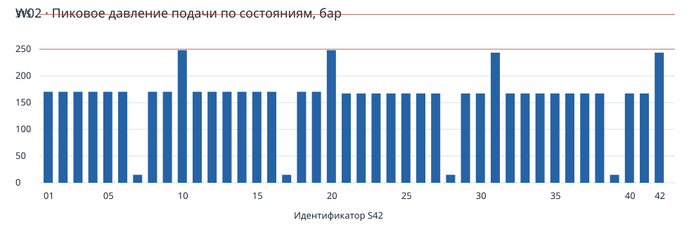
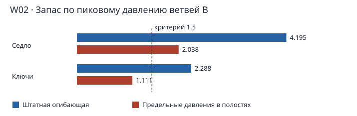

# T-R3-FORCE-CALC-02 — W02, 42 состояния, 1,5 МН

**Инженерный итог `FAILED` в области `CALCULATED_ASSUMED`.** В штатной
огибающей выполнены заданные критерии. При проверке допустимых давлений
в полостях запас по пиковому контактному давлению ключей B составляет
1,111 при требовании ≥1,5. При рассогласовании цилиндров ход остаётся
допустимым, но результат по зазору чувствителен к креплению направляющих.
[Инженерный отказ](engineering_failure_note.md)

Все 42 исходных ID сохранены. В [индексе](results/index.json) приведены
счётчики и экстремумы каждого случая, ссылки на журналы и перечень критериев.
Номера строк отсчитываются с 1. Физические входы и все 42 физических
состояния имеют статус `BLOCKED_INPUTS`. Физические §§4/5/6 имеют статус
`NOT_RUN`. [Аудит входов](input_audit.md)

## Штатная огибающая и границы по давлению

| Величина | Два цилиндра, штатная огибающая | Границы / рассогласование |
| --- | ---: | ---: |
| Пиковая потребность в давлении подачи, выдвижение / втягивание | 170,333 / 248,200 бар | Аварийный реверс одним цилиндром требует 498,814–508,524 бар подачи по расчёту |
| Обычный возврат −12 кН с трением | ≤14,952 бар | — |
| Точки вне хода | 0 из 98, ход 35,000–671,389 мм | Механический диапазон 0–700 мм |
| Минимальный запас штока / траверсы | 10,876 / 6,056 | 5,476 / 2,796 |
| Минимальный запас по всем сечениям и контактам, проверенным R3 | 2,145, резьба тяг пуансона | **1,111, ключи B** |
| Максимум `compression_over_euler` | 0,0525 | 0,1117 |
| Минимальный оставшийся зазор пуансона | 0,552 мм | −2,142 мм при шарнирных концах, +0,210 мм при заделанных |

250–315 бар — диапазон сравниваемой подачи. Давление, необходимое для
отдельного движения или удержания, вправе быть ниже 250 бар. Максимум
248,200 бар включает 5 бар падения подачи и оставляет 1,800 бар до нижней
проверяемой подачи. Для аварийного реверса с равными усилиями осевое
удержание даёт стендовая ветвь огибающей. Рейтинг удержания со стороны
установленных клапанов и узлов машины имеет значение `null`.



Из 2 518 штатных сочетаний 1 152 — удержание, 1 152 — предел трения при
скольжении, 98 — контроль с одной только условной нагрузкой от веса.
Остальные 116 сочетаний имеют ненулевую осевую силу и отпущенную связь.
Для них сохранены `NO_STATIC_EQUILIBRIUM`, подписанная осевая невязка и
`null` для §§4/5/6. Для остальных строк проверены шесть уравнений
равновесия подвижной части и рамы при обеих схемах креплений.
[Границы при давлениях в полостях](results/pressure_bounds.jsonl) содержат
отдельные 1 512 сочетаний, в том числе 24 ниже критерия запаса и 726 с
выбором зазора при шарнирной постановке.

## §4. Реакции и прочность

- Силы двух цилиндров приложены на осях CAD. Осевая нагрузка на пуансон
  имеет смещения Y ∈ {−75, 0, +75} мм и Z ∈ {−30, 0, +30} мм. На каждой
  станции направляющих учтено условное 50 кН вниз. Две знаковые пары
  поперечных реакций получены из ΣF = 0 и Σ(r × F) = 0. Нагруженная
  площадка выбирается по знаку нормальной реакции, а скольжение добавляет
  силу μN по X с плечом на стороне контакта и μ = 0,045.
- На раме записаны силы обоих креплений цилиндров и осевой ответ выбранной
  ветви. Для каждой балки записаны реакции на обоих торцах и передаваемые
  моменты. Четыре тяги на Y/Z = ±850 мм рассчитаны как группа осевых связей
  равной жёсткости. Журналы дают осевые требования с обоих концов. Реакции
  фактических анкеров и распределение по болтам фундамента остаются
  `UNKNOWN`; реакция для баланса условного веса введена как глобальная.
- Штоки проверены по σ = N/A, пальцы по изгибу и срезу, проушины по
  давлению смятия и вырыву. Для полосы траверсы шириной 850 мм и толщиной
  280 мм сравниваются сумма изгибающих требований и поперечный срез по
  номинальному сечению. Проверены также пуансон, тянущие крепления и резьба,
  тяги рамы и срез пальцев направляющих. Пределы материалов и коэффициенты
  принадлежат условной постановке R4. Местные концентрации, преднатяги,
  сварные швы и усталость требуют отдельной модели.

## §5. Устойчивость и зазоры

`P_cr = π²EI/(KL)²`. Свободная длина штока от торца направляющей
цилиндра до пальца составляет `140 + stroke` мм. Проверены K = 1 и 2.
Пуансон сравнивается по длине 740 мм с K = 2, рама по сжатым осевым тяжам
3280 мм с K = 1. Каждый результат отмечает применимость упругой формулы
по отношению `P_cr/A` к пределу текучести. Суммарная потеря устойчивости
рамы и диаграмма устойчивости поставного цилиндра остаются открыты.

Прогибы балок вычислены по Эйлеру–Бернулли для шарнирных и заделанных
концов. Положение жёсткой подвижной группы по двум станциям перенесено
на перекрытие пуансона и камеры. Отрицательный остаток зазора означает
необходимость пересчитать реакции с контактом камеры. В этих строках
сохранены реакции пробной схемы с направляющими и `null` для
перераспределения после контакта. Сеточная сходимость неприменима к
аналитической схеме. Верификатор проверяет балансы и закрытые решения,
включая прогиб по центру для обеих схем крепления.

## §6. Седло и ключи B

Рассмотрены две крайние ветви с передачей полной осевой силы по одной
из них. Жёсткий затвор опирается на две равножёсткие прямоугольные
площадки. Принято `p(y,z) = max(0,a + by + cz)`. По сжатым частям
площадок точно интегрируются сила и первые моменты, с проверкой
`F`, `F e_y` и `F e_z`. Давление сравнивается с условным пределом
250 МПа для опоры. Распределение при совместном контакте зависит от
жёсткости, плоскостности и зазоров деталей. В открытой ветви B реакция
затвора, седла и ключей равна нулю по граничному условию.

| Ветвь | Штатный пик, МПа | Пик при 315 бар, МПа | Запас при 315 бар |
| --- | ---: | ---: | ---: |
| Седло | 59,60 | 122,67 | 2,038 |
| Ключи | 109,28 | 224,94 | **1,111** |



## Расход, энергия и матрица

Пара цилиндров вытесняет 105,36 л за проход всей огибающей туда и обратно.
Это 158,04 с при сравнительных 40 л/мин или 1 053,62 л/мин для 6 с.
Рабочий интервал 351,111 мм требует 34,47 л по паре поршневых полостей.
Сценарий постоянной пиковой нагрузки даёт механическую работу A/B
538,05 / 527,52 кДж и расчётную работу питания 587,14 / 576,22 кДж.
При 30 кВт соответствующие границы по энергии — 19,57 / 19,21 с.
Это сценарии сравнения с 180 кДж из 30 кВт × 6 с. Фактическая длительность
и запас мощности зависят от профиля нагрузки и агрегата.
[Фазовые объёмы, мощности, энергии и времена](results/phase_hydraulics.json)

Номинальный пуансон 300 × 220 мм, проход 304 × 224 мм и выход 150 × 60 мм
дают отношение площади пуансона к площади продукта 7,333. Среднее по
торцу пуансона при 1,5 МН составляет 22,73 МПа. Деление той же силы на
площадь выходного профиля даёт 166,67 МПа как показатель масштаба.
Фактические давление формования, трение и работа матрицы имеют значение
`null` до задания закона уплотнения и течения.

## Воспроизведение

Python 3.12+ и PyYAML из requirements.txt. Из корня репозитория с
материализованными FCStd из Git LFS.

```text
python scripts/check_registry.py --check-git
python -m unittest discover -s tests -v
python verify_output.py --check-git
python cae/cases/T-R3-FORCE-CALC-02/verify_output.py --check-git
```

`--write` у верификатора пакета заново строит файлы результатов.
PASS команд относится к целостности и воспроизводимости расчёта.
Независимая проверка R5 и решение о выпуске остаются открыты.
[Входы и среда](input_manifest.json) · [SHA-256 выходов](output_manifest.json)
