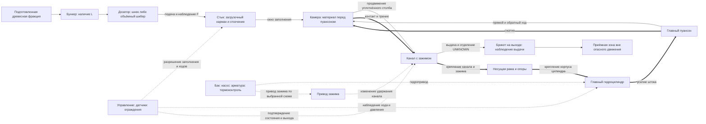
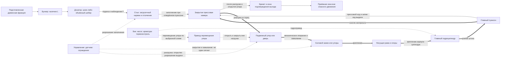

# REV — функциональные эскизы всего пресса

Ревизия 1; DRAFT / NOT_SELECTED / NOT_RUN; Codex / R1 / codex-01;
T-INIT; 2026-11-10 UTC. База: `f154a1444bbd75040b3be8c515dedc873ff611c2`.
Это собственные качественные варианты для сравнения, не рабочие чертежи,
не расчёт прочности и не принятая архитектура. Размеры, ходы, массы, усилия,
давления, мощности, времена/пороги и производительность UNKNOWN.

## Общие границы и легенда

До пресса — имеющиеся сортировка/металлосепарация/дробление/просев. Вход —
описанная подготовленная древесная фракция строительного мусора после удаления
металла; покрытия и примеси учитывать по паспорту. Конечная влажность/фракция
и необходимость дополнительной подготовки UNKNOWN. Выход — выданный брикет
на согласованной границе машины; упаковка/рынок не определяют этот выбор.

Каждый эскиз охватывает бункер, сменный по концепции дозатор, стык заполнения,
силовой узел, выдачу, раму, гидроагрегат, управление/ограждения. Шнек или
объёмный шибер могут рассматриваться для обоих вариантов, пока не выбран
дозатор. Взвешивание отдельной дозы из TEST-F-02 — отдельный испытательный
узел; весы не включены автоматически в производственный пресс.

В схемах `-->` — путь материала или движение, указанное подписью;
`==>` — цепь передачи реакции в фазе прессования, а не направление всех
векторов силы; `-.->` — управление/наблюдение/энергоснабжение по подписи.
Замкнутая цепь толстых стрелок показывает, через какие элементы должна
передаваться реакция. Оба силовых контура — гипотезы с недоказанной несущей
способностью; гидроагрегат не заменяет механического замыкания рамы.

## Вариант A — канал с зажимом

**Стык дозатора с камерой.** Доза поступает в загрузочный карман/окно при
отведённом пуансоне. До силового хода подача прекращается, загрузочный
интерфейс должен занять подтверждённое изолированное положение и не допускать
обратного выброса. Ползун может совмещать подачу/отсечение только после
собственной проверки кинематики и нагрузок; вал/привод шнека не считать
силовым затвором камеры. Какой элемент закрывает окно и как передаёт реакцию
на корпус/раму — UNKNOWN, обязательная задача проектирования.

Последовательность движений и условий:

| Фаза | Движения и материал | Что подтвердить до следующей фазы |
|---|---|---|
| A-FILL | Пуансон отведён; дозатор подаёт материал в карман/камеру | Фактический приход/состояние заполнения и положение пуансона; наличие L недостаточно |
| A-ISOLATE | Дозатор завершает подачу/отходит, окно камеры отсекается; зажим занимает состояние удержания | Нет пересечения траекторий, затвор опирается на предназначенные элементы; состояние зажима наблюдаемо |
| A-PRESS | Главный пуансон идёт вперёд; материал уплотняется и продвигает столб в канале против сопротивления | Ход/давление/состояние канала, отсутствие обратного выброса и непредусмотренной перегрузки; критерии UNKNOWN |
| A-RETURN | Управляемая разгрузка привода и возврат пуансона; удержание столба должно препятствовать обратному движению | Реальная способность удержания и состояние остаточного материала; режим зажима при возврате ещё требует обоснования |
| A-OUT | Продвинутый материал достигает выхода; способ отделения изделия/границы порции определяется исследованием | Фактическая выдача, отсутствие подпора/застревания; следующая доза не предполагается равной одному брикету |

A-OUT связан с продвижением в A-PRESS; таблица не задаёт несуществующий
независимый такт резки или автоматическое отделение после каждого хода.
Формирование начального сопротивления при пустом канале, стартовый режим,
удержание при возврате и завершение/очистка остаточного столба UNKNOWN.
Нельзя считать их обеспеченными одним названием «зажим».

**Силовой контур:** корпус цилиндра/его крепление → цилиндр и шток → пуансон →
материал → стенки канала/зажим → крепление прессового модуля → рама →
крепление корпуса цилиндра. Продольная реакция контакта и поперечные нагрузки
зажима проверяются отдельно. Стыки корпуса/рамы и загрузочный затвор также
получают свои нагрузки; опора на пол не заменяет проверки замкнутого контура.

Идеи для сравнения: зажим/канал WEIMA TH200 (PDF 24/30/33), разрезная втулка
и прессующий модуль PRODECO E55 (PDF 5/20/21/24/30). У WEIMA отдельный
пользовательский регулятор усилия не доказан; настройки источников не перенесены.

## Вариант B — закрытая камера с открываемым упором и выталкиванием

**Стык дозатора с камерой.** Принцип приёма дозы тот же: загрузка при
отведённом пуансоне, затем подтверждённое отсечение входа/вывод дозатора из
траектории. Перед прессованием дополнительно подтверждаются закрытие упора
и его силовое замыкание. Датчик «дверь закрыта» сам по себе не доказывает
восприятие усилия замком/упорами. Кинематика окна, уплотнение и реакция на
загрузочный затвор UNKNOWN и не возлагаются на дозатор без расчёта.

В этом эскизе выталкивает главный пуансон после открытия торца; отдельный
выталкиватель не выбран. Достаточность хода, направляющих и свободного
пространства для такой операции UNKNOWN, её надо проверить до принятия схемы.

| Фаза | Движения и материал | Что подтвердить до следующей фазы |
|---|---|---|
| B-READY | Главный пуансон отведён, выходной упор закрыт и силовая связь замкнута | Отдельно положения, замыкание и готовность зоны выхода; размеры/нагрузки UNKNOWN |
| B-FILL | Дозатор заполняет камеру, затем отходит/останавливается; вход отсекается | Реальное заполнение, безопасное положение дозатора и опирание входного затвора |
| B-PRESS | Главный пуансон движется к закрытому упору, материал уплотняется | Ход/давление и физический результат, нагрузка силового контура/упора, критерии UNKNOWN |
| B-UNLOAD | Управляемое снятие воздействия, при необходимости отвод пуансона до безопасного состояния | Нагрузка на упор/замок действительно снята; низкое давление масла само по себе не доказывает отсутствия остаточного усилия упругого материала |
| B-OPEN | После подтверждённой разгрузки силовой замок освобождается, упор отходит из пути изделия | Полное освобождение траектории и исключение опасного движения упора; способ/направление UNKNOWN |
| B-EJECT | Главный пуансон выполняет ход выдачи через открытый торец | Фактическая полная выдача, отсутствие застревания/разрушения, допустимость усилия и свободный ход |
| B-RESET | Пуансон отведён, выход очищен/проверен, упор возвращён и замкнут | Нет остатка в зоне закрытия и пересечения движений; следующий цикл только после подтверждений |

**Силовой контур:** корпус цилиндра/крепление → шток/пуансон → материал →
упор/дверь → механический замок или силовые упоры → рама → крепление
корпуса цилиндра. Конкретное конструктивное замыкание UNKNOWN: замок на
рисунке — кандидат для обеспечения реакции, а не найденная/проверенная
деталь ARS. Привод перемещения двери не объявлен единственной силовой
опорой. Если вместо механического замыкания рассматривать силовое удержание
цилиндром, это отдельная схема с проверкой нагрузки/энергии/отказов.

Идеи для сравнения: камера/дверь и цикл ARS RST500 (PDF 6–7/16–17, узлы
цилиндров PDF 38–39). Полный силовой контур его рамы не подтверждён этими
чертежами; эскиз выше — собственная гипотеза REV, не копия конструкции ARS.
Отличия металлического/иного сырья ARS не позволяют переносить режимы на REV.

## Какие данные нужны для выбора

| Данные/проверка | Для канала и зажима | Для камеры и выталкивания | Как получить / сейчас |
|---|---|---|---|
| Состояние реальной древесной фракции | Стабильность заполнения/трения канала | Заполнение и влияние на закрытие/выдачу | Состав, покрытия/клей/примеси, остаточный металл, влажность, частицы/форма, плотность по паспорту; значения UNKNOWN |
| Уплотняемость и возвратное расширение | Устойчивое сопротивление и удержание столба | Остаточное усилие на упор и освобождение камеры | Собственные зависимости воздействия/хода, состояния после разгрузки/выдержки; измерения пока отложены, NOT_RUN |
| Подача/дозирование | Связь нескольких доз со столбом/выходом | Заполнение камеры/неполные порции | TEST-F-01/02, раздельные L/F/M, масса дозы — вход для формования; результаты UNKNOWN |
| Трение, износ и заклинивание | Усилие зажима, контакт стенок, нагрев, очистка | Трение при выталкивании, застревание, усилие выдачи | Опыты и выбор материалов/сменных элементов; никаких готовых коэффициентов источников |
| Требуемая геометрия/повторяемость изделия | Возможность формирования/отделения в канале | Возможность формирования и выдачи в полости | TEST-F-03/04; размеры и пороги UNKNOWN до обоснования, доза не равна брикету автоматически |
| Силовые/кинематические случаи | Осевые/поперечные реакции канала и зажима | Реакции упора/замка, безопасное открытие и ход выдачи | Собственные силовые схемы/расчёты и последующая независимая проверка; размеры/усилия UNKNOWN |
| Цикл и гидропривод | Пуск пустого канала, удержание при возврате | Разгрузка, открытие, выдача, повторное замыкание | Автомат состояний и энергетические/тепловые балансы; времена/расходы/производительность UNKNOWN |
| Изготовление и обслуживание в РФ | Канал/зажим/направляющие, замена износа, соосность | Камера/упор/замок, рама, доступ к очистке, ход цилиндра | Свои материалы/обработки/сборка, подтверждение подрядчиков и доступных COTS; возможности/стоимость UNKNOWN |

Сначала сформировать сопоставимые собственные входы и критерии, затем
сравнить варианты по функциям, рискам, изготовимости и обслуживанию.
Достоверного выбора, расчёта или численного ранжирования сейчас нет.
Оба эскиза сохраняются как варианты; G1 открыт до независимой проверки
и утверждения ТЗ пользователем. Испытания не запускались.
