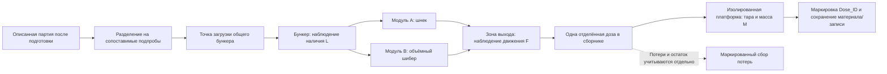

# REV — схема испытательного узла приёма и дозирования

Ревизия 3. DRAFT / NOT_RUN. Codex / R1 / codex-01; T-INIT; 2026-11-10 UTC.
Начальная база: `b408f9d329e00a67621962888429b9223497ddb7`.
Основания: прямое поручение пользователя, NEXT_MODEL.md, F-REV-01/02,
TEST-F-01/02, process/feedstock.md и sampling_plan.md (rev2), сравнение
sources/function_realization_comparison.md. Схема функциональная: наличие/сборка стенда не подтверждены,
запуск не выполнялся, датчики/приводы не выбраны.

## Граница узла и путь сырья

До точки загрузки выполняются имеющиеся сортировка, металлосепарация,
дробление и просев. На стенд поступает описанная подготовленная древесная
фракция строительного мусора после удаления металла. Влажность, фракция,
форма частиц, плотность, примеси и остаточный металл UNKNOWN до измерений.
Сушка/иная доподготовка не предполагается без отдельного обоснования.



В каждый прогон установлен только один модуль A или B: параллельного
питания одного сборника нет. Общий бункер/выход и сменный интерфейс —
предложение для сопоставимости, их конструктивная реализуемость UNKNOWN.
Геометрия горловины/адаптера и состояние стенок фиксируются для каждого
варианта; если их нельзя сделать сопоставимыми, сравнивается модуль целиком,
а не изолированный эффект «шнек против шибера».

Модуль A: регулируемая подача шнеком, команда дозы через выбранные скорость,
поворот/время и пуск/останов. Модуль B: объёмный загрузочный шибер/ползун
с заполнением полости и её переносом/выталкиванием, команда через выбранные
ход, положения и фазы заполнения/опорожнения. Площадь/объём/ход UNKNOWN.
Простая заслонка, открывающая самотёк, — иная реализация; её нельзя молча
считать эквивалентом объёмного шибера из исследованных машин.

Этот узел заканчивается отдельной взвешенной дозой. Вместо прессовой камеры
используется приёмный сборник, поэтому не воспроизводятся автоматически
сопротивление заполнения камеры и взаимодействие с работающим прессом.
Их проверка — отдельный интеграционный этап TEST-F-03/05.

## Три независимых наблюдения

| Канал | Что именно наблюдается | Предлагаемое средство, исполнение UNKNOWN | Что не следует из сигнала |
|---|---|---|---|
| L — наличие | Есть ли материал в заданной зоне бункера; фактическое состояние загрузки | Датчик наличия/уровня плюс фиксированная визуальная зона контроля; способ/положение и границы уровней согласовать | Наличие у датчика не доказывает заполненную горловину, движение или массу дозы |
| F — движение | Действительное прохождение частиц через определённую выходную зону во времени | Отдельный датчик потока либо видеозапись зоны с разметкой времени; проверить пыль, перекрытие и остаточные частицы | Команда приводу, вращение шнека, ход шибера или сигнал L не являются измерением потока |
| M — масса | Масса содержимого отдельного сборника за определённую дозу | Независимая весовая платформа/весы, тара перед дозой и устойчивое показание после окончания прихода | Масса не определяет историю движения, причину остановки, заполненность камеры или свойства брикета |

L, F, M имеют отдельные исходные записи и общий временной отсчёт. Состояния
«есть», «нет» и «неизвестно/канал недостоверен» различаются. Поле без сигнала
не заменяется на «нет». Показание M можно сопоставить с F, но нельзя выдавать
изменение массы за независимое подтверждение F при отсутствии его записи.
Команда подачи и подтверждение движения привода/положения записываются
дополнительно: они помогают диагностике, но не заменяют наблюдение материала.

## Короткая таблица измерений

Временная база общая для Series_ID/Dose_ID. Частоты, разрешение времени,
допустимая рассинхронизация, окна и пороги UNKNOWN до обоснования.

| Сигнал | Точка наблюдения | Привязка ко времени | Правило недостоверной записи |
|---|---|---|---|
| L: наличие материала | Заданная зона бункера, отдельно от горловины/потока | Исходное состояние перед командой и изменения по всему окну дозы | Загрязнение/перекрытие зоны, непроверенная чувствительность, пропуски или неподтверждённое состояние канала → INVALID/UNKNOWN, не «материала нет» |
| F: движение материала | Определённое сечение выхода дозатора; поток/видеозона | Начало, конец и интервалы движения/отсутствия движения с общей меткой времени, включая выбег/досып | Потеря кадров/данных, отсутствие связи, закрытая/запылённая зона, недостаточная наблюдаемость или неподтверждённая исправность → SIGNAL_LOSS либо INVALID, не отсутствие движения |
| M: масса отдельной дозы | Независимый сборник/весовая платформа | Тара перед дозой; брутто после конца прихода и подтверждения устойчивости; Dose_ID связывает записи | Нет тары/устойчивости, неизвестный дрейф/калибровка, силовая связь с механизмом, смешение соседних доз или неучтённый обход весов → INVALID; значение не заменять нулём |
| CMD / POS: команда и фактическое положение/движение привода | Контроллер и обратная связь шнека/шибера | Команда, подтверждённый пуск/останов/ход и изменение настройки | Нет обратной связи или меток/совпадения ревизии настройки → фактическое действие UNKNOWN; команда не доказывает поток |
| T / SYNC: синхронизация и качество записи | Регистратор и метки каналов/видео | Общее начало серии, интервалы записи, привязка всех событий к Dose_ID | Разрыв/скачок времени, неизвестное смещение каналов → межканальный вывод за интервал недостоверен, исходные записи сохранить |

Для F хранить отдельно наблюдение и качество: `MOVING` — движение подтверждено;
`NO_MOTION_CONFIRMED` — в определённой зоне/интервале достоверной записи
движение отсутствует; `UNKNOWN` — достоверного вывода нет. Подтверждение
NO_MOTION требует проверенной чувствительности/работоспособности канала,
обозреваемой зоны и непрерывного покрытия нужного интервала. Способ проверки
канала до/после серии и контрольная визуальная запись задаются программой,
численные правила пока UNKNOWN. Отсутствие импульсов или низкий логический
уровень сами по себе не подтверждают неподвижность материала.

Потерю связи/кадров (`SIGNAL_LOSS`) и прочие причины `INVALID` записывать
с интервалом, причиной и исходным файлом; F-наблюдение тогда UNKNOWN.
Подтверждённое отсутствие движения относится только к наблюдаемой зоне,
не доказывает свод или отсутствие сырья во всём тракте. EVT-NOFLOW допускает
лишь достоверный NO_MOTION_CONFIRMED в обоснованном ожидаемом окне подачи;
потеря F относится к EVT-MEASURE, а не к статистике пропусков подачи.

## Граница отдельной дозы и взвешивание

Предлагается порционный режим с одним сборником: до разрешения следующей
дозы предыдущая отделена, взвешена и удалена/маркирована, тара проверена.
Подача не идёт одновременно с заменой сборника. Сборник и весовая платформа
не должны получать неизвестную силовую связь от вибрирующего дозатора,
рукавов или опирающегося материала; способ развязки и защита от просыпи
UNKNOWN до проектирования. Не допускать обхода весов неучтённым потоком.

До будущего прогона определить проверку весов/тары, рабочий диапазон,
разрешение, неопределённость, правило устойчивости и допустимый дрейф.
Все значения UNKNOWN. Символическая масса дозы: `m_dose = m_gross - m_tare`;
численные значения не вычислялись, единица и метод фиксируются в протоколе.

Цикл записи дозы:

1. Назначить Dose_ID, связать с партией/подпробой, механизмом и настройкой.
   Проверить пустой сборник и записать тару; подтвердить готовность записи L/F/M.
2. Зафиксировать исходные загрузку/L, положение механизма и разрешение подачи;
   выдать команду только по будущей согласованной программе. Записать команду
   и фактическое начало движения материала отдельно.
3. По всему окну дозы записывать L, F, события привода, изменение уровня,
   остановы/зависания и вмешательства. Начало/конец окна определяются заранее,
   но численно пока UNKNOWN.
4. После останова механизма учесть выбег/досыпание и запаздывание по тракту.
   Установить конец прихода по независимому F и согласованному правилу,
   затем записать устойчивое M. Времена ожидания/пороги UNKNOWN; отсутствие
   движения по команде само по себе не означает, что вся доза уже собрана.
5. Поздний досып, материал в тракте и просыпь связать с Dose_ID по заранее
   согласованному правилу. Если принадлежность неясна, пометить дозу как
   неразделённую/измерение недостоверно; не прятать её и не добавлять молча
   в следующую дозу. Потери/остаток сохраняются в отдельной записи.
6. Записать брутто, тару, нетто, неопределённость/статус измерения и файлы.
   Маркировать дозу; очистить/проверить сборник для следующего цикла по
   безопасной процедуре. Возврат материала в бункер в той же серии не предполагается.

Это проект будущей последовательности, не выполненные действия. Порционное
сравнение включает пуск/останов модулей и не доказывает их эффективность в
непрерывном режиме; непрерывная подача потребует отдельной серии/методики.

## Зависания, пропуски и неполные дозы

Все события регистрировать, а не исключать неудачные циклы из серии.
Диагноз и исходное наблюдение разделяются; границы временных окон,
достоверности и массовые пороги пока UNKNOWN.

| Код | Наблюдение/основание будущей записи | Что проверить и как трактовать |
|---|---|---|
| EVT-NOFLOW | Команда подачи дана, исправный/наблюдаемый F подтверждает NO_MOTION_CONFIRMED в ожидаемом окне; L и действие привода записаны | Причину (пустой вход, свод, неполный ход, задержка) определять отдельно. SIGNAL_LOSS/INVALID → EVT-MEASURE, не пропуск подачи. До обоснования окна — кандидат события, не автоматический FAIL |
| EVT-BRIDGE | При наличии материала прекратился поток; возможен свод/зависание | Записать L/F, состояние горловины/привода и безопасное визуальное подтверждение. Без подтверждения — «предполагаемое зависание», не доказанная причина. Очистка только после останова/изоляции энергии |
| EVT-SHORT | Есть признаки неполного заполнения полости/хода или недостаточного прихода материала | Записать наблюдаемый признак и фактическую массу. Неполный ход и малая масса — разные признаки; без согласованной опорной массы/допуска нельзя объявить дозу количественно неполной или браком |
| EVT-TAIL | Приход после команды останова/вне первоначального окна | Сохранить время и принадлежность досыпа; не смешивать соседние дозы |
| EVT-SPILL | Просыпь/обратный выброс/остаток в тракте | Записать место, собрать отдельно и учитывать по дозе/серии; правила измерения UNKNOWN |
| EVT-INTERVENTION | Очистка, рыхление, изменение настройки, повторная команда или смена партии | Сохранить время, основание и эффект; отметить границу сегмента до/после. Не заменять исходный неудачный цикл удачным повтором |
| EVT-MEASURE | Нет записи L/F/M, дрейф тары, весы неустойчивы или дозы не разделены | Пометить достоверность и сохранить исходные файлы. Не принимать отсутствующие данные за нулевой поток/массу |

Одна доза может иметь несколько событий. Отсутствие признака не доказывает
отсутствие сбоя вне наблюдаемой зоны. Нулевая/неотличимая от тары масса
определяется по будущей метрологической методике, а не по одному округлённому
показанию. До обоснования пределов сохраняются исходные данные и описание,
а итоговая приёмочная оценка — NOT_RUN/не назначена.

## Как сравнить A и B на одинаковом сырье

«Одинаковое сырьё» означает сопоставимые подпробы одной охарактеризованной
партии в одном состоянии подготовки, а не просто общее название древесины.
Планировать разбиение без сегрегации мелочи/крупных фрагментов, контроль
влажности/фракции/плотности/примесей и сохранение условий хранения.
Фактические характеристики UNKNOWN до отложенного измерительного этапа.

- Сравнивать при согласованном исходном заполнении общего бункера и одинаковой
  точке загрузки/выхода, насколько допускает конструкция. Изменение уровня,
  адаптера/горловины, рыхлителя и подпора записывать; это факторы, а не скрытые
  различия. Не приписывать результат только типу привода при разных трактах.
- Подпробы для A/B готовить заранее из одного слоя выборки. Очерёдность
  блоков чередовать/рандомизировать по плану, чтобы расходование партии,
  высыхание и дрейф настройки не совпадали с одним механизмом. Число блоков,
  повторов и порядок UNKNOWN. Не использовать уже пропущенный через A материал
  как «тот же» вход B без отдельного учёта изменения частиц/состояния.
- Сначала исследовать собственную карту «команда → фактическая масса дозы»:
  для A поворот/скорость/время, для B заполнение/ход/фазы. Одинаковая длительность
  команды не означает одинаковую дозу. Размеры, нагрузки и настройки UNKNOWN.
- Затем выбрать обоснованную общую опорную массу из перекрывающихся областей
  работы модулей и согласовать правило сопоставимости средних доз. Пока
  `m_ref = UNKNOWN`, массовый допуск UNKNOWN; не считать их равными молча.
  Не подгонять каждую отдельную дозу вручную и не отбирать только удачные циклы.
- В фиксированных состояниях сравнить распределения массы доз, время появления
  потока/выдачи дозы, пропуски, предполагаемые/подтверждённые своды, неполное
  заполнение, досып/потери и вмешательства. Регистрировать всю серию. Правила
  нормирования частот, методы статистики и пороги UNKNOWN до программы.
- Дополнительно сравнивать пуск/паузы и изменение заполнения/кондиции, сохраняя
  остальные факторы либо явно разделяя их. Ограничения стенда и неопределённость
  включать в вывод; победитель не назначен, пригодность под нагрузкой камеры
  этим опытом ещё не доказана.

## TEST-F-02 и VAL-REV-03: граница вывода

TEST-F-01 проверяет приём/движение материала, TEST-F-02 — дозирование и массу
выделенной дозы. Масса/состояние дозы — **входные данные** для оценки формования
по VAL-REV-03/REQ-REV-03; одной повторяемости доз недостаточно для положительного
вывода о повторяемости брикета. Формование и выдача готового изделия проверяются
отдельно в TEST-F-03/04, включая массу/геометрию, дефекты и выдержку/пружинение.

На настоящем автономном узле формования нет. В интеграционном опыте связать
Dose_ID → цикл прессования → Briquette_ID либо явно зарегистрировать объединение
нескольких доз, удержание материала/остаток в камере и потери. Не предполагать,
что одна измеренная доза всегда равна одному брикету или его массе. До такой
проверки VAL-REV-03 остаётся NOT_RUN, даже если журнал TEST-F-02 будет заполнен.

## Пустая форма серии TEST-F-01/02

Ниже шаблоны, не записи выполненных опытов. Все null — незаполненные данные;
проектные численные значения UNKNOWN. Пустые списки не означают нулевые
отказы. Отдельный файл серии создаётся только при будущем разрешённом выполнении.

```yaml
record_type: test_series_template
series_id: null
tests: [TEST-F-01, TEST-F-02]
status: NOT_RUN
base_commit: null
operator: null
independent_reviewer: null
material:
  lot_id: null
  preparation_state_id: null
  subsample_assignment: null
  moisture_method_basis_and_result: null
  particle_distribution_shape: null
  bulk_density: null
  composition_coatings_impurities_residual_metal: null
  storage_conditions: null
setup:
  module_A_revision_and_geometry: null
  module_B_revision_and_geometry: null
  hopper_adapter_loading_and_outlet: null
  drive_commands_and_feedback: null
  level_L_channel_and_validation: null
  flow_F_channel_and_validation: null
  mass_M_instrument_calibration_and_uncertainty: null
  timebase_and_sync: null
  channel_health_checks_and_validity_rules: null
  dose_window_lag_tail_and_stability_rules: null
  loss_collection_and_tare_check: null
  safety_and_energy_isolation: null
design:
  block_order_and_repeats: null
  settings_map_and_matched_conditions: null
  reference_mass_and_matching_rule: null
  event_definitions_windows_and_thresholds: null
  dimensional_load_and_operating_limits: null
  acceptance_criteria_and_parameter_revisions: null
cycles: []
events: []
series_losses_and_material_balance: null
raw_files_and_hashes: []
comparison_and_limitations: null
verdict: null
```

Шаблон одной будущей строки дозы, без созданного результата:

```yaml
record_type: dose_record_template
series_id: null
block_id: null
dose_id: null
module_and_setting_id: null
lot_and_subsample_id: null
command_start_stop_and_drive_feedback: null
initial_loading_and_level_L_trace: null
flow_F_start_stop_gaps_and_trace: null
flow_F_observation_and_quality_by_interval: null
flow_F_signal_loss_intervals_and_reason: null
channel_validity_and_sync_by_interval: null
tare_gross_net_mass_unit_uncertainty: null
mass_stability_and_measurement_validity: null
late_arrival_spill_and_residue: null
events_and_interventions: []
observed_fill_or_stroke_completion: null
short_dose_assessment_and_basis: null
raw_files_and_hashes: []
future_press_cycle_and_briquette_links: null
notes: null
```

Пустой журнал событий:

| Series_ID / Dose_ID | Время / ссылка L/F/M | Код | Наблюдение | Диагноз предполагаемый/подтверждённый и основание | Вмешательство / результат | Достоверность данных |
|---|---|---|---|---|---|---|
|  |  |  |  |  |  |  |

## Незаданные величины и следующий шаг

Геометрия/размеры, силы/нагрузки, скорости/ходы, объёмы, времена, целевая
масса/допуски, число повторов, диапазоны приборов, пороги событий/годности
UNKNOWN. Не использовать числа BP500/WEIMA/E55/ARS или нормы пеллет как
готовые параметры REV. Следующий документальный шаг — обосновать измерительные
каналы и диапазоны после собственных требований к стенду, затем независимый
review программы. Испытания не запускались и этим документом не разрешаются.
G1 открыт, ТЗ/архитектура и выбор механизма не утверждены.

## Уточнение после R5-TZ-W04: пригодность F до сравнения

До серии определить наблюдаемую зону F, физический принцип, материал/фракции,
область чувствительности и пределы применения (все значения UNKNOWN).
Проверить по отдельной программе реакцию канала на независимо подтверждённое
движение и его отсутствие в этой зоне, обнаружение отключения/обрыва/залипания
и регистрацию ошибок. Средство независимого подтверждения и охват сценариев
подлежат выбору и review; один сигнал F не подтверждает собственную исправность.

Согласовать и проверить общую шкалу времени L/F/M, погрешность синхронизации
и задержки. Окно наблюдения и порог регистрации отсутствия движения задаются
по характеристикам материала/метода и исследованию; пока UNKNOWN. На каждом
интервале сохранять исходный сигнал, качество/самодиагностику, статус покрытия
наблюдаемой зоны и результат проверки времени. NO_MOTION_CONFIRMED допустим
только при пригодном канале и полном наблюдении заданного окна. SIGNAL_LOSS,
INVALID или неизвестная пригодность дают INDETERMINATE для движения в этом
интервале; его не учитывать как доказанный пропуск и не скрывать при оценке
полноты серии. Причина свода/пустоты/неисправности — отдельное заключение по
независимым данным, не автоматический вывод F. Испытания NOT_RUN; R5-OBS-04 OPEN.
