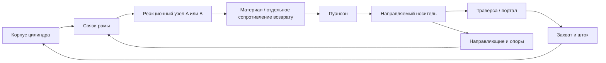

# Свободные тела и условное замыкание силы

Система координат исходного предложения: +x к выходу, +y поперёк к боковому
цилиндру V2, +z вверх. Знак внутреннего N положителен при растяжении.
Ни абсолютные координаты, ни реальные плечи/опоры не назначены.

Стрелки показывают топологию нагрузочного контура, а не направление векторов,
доказанную геометрию или существование каждого контакта. Для V1 цилиндр сзади,
для V2 сбоку; на вариант остаётся один полный исходный цилиндр.

## Два именованных идеальных нагрузочных случая

**S_WORK:** приложить к идеальной последовательной цепи полный source
F_work_peak. **S_RETURN:** испытать ту же захваченную цепь полным source
F_return_required в обратную сторону. Это проверка передачи заданной нагрузки,
а не утверждение, что вся исходная нагрузка физически сосредоточена на пуансоне.
У исходного R3 force_work_peak уже есть условные guide/channel составляющие,
а return_required включает исходный guide. Их не прибавлять второй раз.
Новые распределённые трение, масса/инерция и боковые нагрузки UNKNOWN.

Идеальная модель — квазистатика, неизменное передаточное отношение, жёсткая
захваченная связь, только осевая составляющая и отдельно изолированная моментная
пара. Реальная достаточность/нулевые потери этой модели не утверждаются.
Все новые сопротивления нужно затем добавить с их фактическим местом приложения,
не подменяя source. Реальные усилия в каждом сечении до этого UNKNOWN.

Пусть F_x = +F_work_peak в S_WORK и F_x = −F_return_required в S_RETURN.
В идеальных последовательных звеньях N = −F_x. Равный осевой компонент не
означает одинаковую площадь/напряжение/прочность и не делится пополам для V2.

| Свободное тело / интерфейс | Идеальный осевой компонент | Что нужно дополнительно |
|---|---|---|
| Шток → захват | Полная величина F_x; N штока = −F_x | Резьба/шарнир/срез/смятие, поперечная сила, эксцентриситет, уплотнение, реальное опирание |
| Захват → траверса/портал | Полная величина F_x | Локальные рычаги, группы соединений, изгиб/кручение и податливость |
| Траверса → носитель → пуансон | N = −F_x в идеальной осевой ветви | Собственные сечение/материал/устойчивость/прогиб, двусторонние joints, местные концентрации |
| Корпус цилиндра → опора рамы | На раму действует −F_x по x | Монтаж/порты/крепление COTS, поперечная допускаемая нагрузка, анкерная группа/отрыв |
| Материал → реакционный узел → рама | На раму действует +F_x, **если** соответствующая реакция существует | A startup/удержание или B контакт упор–замок, направление возвратного сопротивления, местные соединения/опоры |
| Направляющие → рама | Силы противоположны R0/R1 на движущем теле | Преднатяг, люфты, реальные контактные стороны, остальные нагрузки и жёсткости |

В S_RETURN требуются захваченные соединения по всей последовательности.
Односторонний контакт толкания не передаёт растяжение. Реакция A/B при возврате
не обязана быть рабочей реакцией с обратным знаком: другой контакт/трение/удержание
и инерция требуют своей схемы; S_RETURN — только заданный тест передачи.

## Эксцентриситет и направляющие

Для осевой силы в точке r = (0, e_y, e_z):
`r × F = (0, e_z·F_x, −e_y·F_x)`.
Значит, применённый M_z = −F_x·e_y. Знаки меняются при возврате или смене стороны
смещения. e_y и e_z у реальной V1 также UNKNOWN: идеальная соосность предложения
не является измеренной нулевой несоосностью. У V2 e_y требуется топологией,
но его величина и положение всего swept volume не известны.

Изолированная простая модель двух направляющих: их относительные координаты
x0 = 0 и x1 = a определяют символический шаг a, а не расположение в CAD.
Нет внешней поперечной силы в **этом выделенном компоненте**:

`R0 + R1 = 0`, `a·R1 + M_z = 0`;
`R1 = F_x·e_y/a`, `R0 = −F_x·e_y/a`.

На раму приходят −R0/−R1. Её осевые силы −F_x на опоре цилиндра и +F_x на
реакционном узле взаимно уравновешены; пара от них F_x·e_y замыкается
противоположной парой направляющих. Это аналитический баланс при заданных
связях, не доказательство прочности или их наличия.

Коэффициенты по e_y и e_y/a вычислены без назначения этих размеров. Реальные M
и R UNKNOWN. Нельзя объявить результирующую нагрузку направляющей только этой
парой: добавляются прочие силы, вес/инерция, преднатяг, местный контакт и другие
плоскости. Для многоопорной/статически неопределимой схемы нужны совместность
деформаций и жёсткости. Равное распределение по болтам/блокам не принималось.
Локальный изгиб/кручение портала/рамы требуют проекций общего момента на оси
каждого звена, геометрии и J/W; формула одного M_z их не закрывает.

## Устойчивость и напряжения

Среднее осевое напряжение цельного условного штока `N/(pi*d²/4)` вычислено по
исходному d; резьба, выточки, изгиб, концентрации, усталость и допуски исключены
из этой номинальной величины и должны проверяться отдельно. Сечение носителя
не приравнивалось штоку или пуансону: его N/A, M/W и совместные напряжения UNKNOWN.
F_work/(width·height) — эквивалентная равномерная тяга условного теста S_WORK,
не физическая контактная эпюра материала и не новая реологическая зависимость.

Для упругого стройного стержня с обоснованными закреплениями:
`Pcr = pi²·E·I/(K·L_free(q))²`.
Вычислен только коэффициент `EI/L_eff² = F_work/pi²` на границе равенства
идеальной собственной нагрузки. Это не проектный минимум и не запас: критерий/
коэффициенты, E, I, K, начальная кривизна, эксцентриситет, диапазон стройности,
пластичность и местная устойчивость неизвестны. Реальный Pcr/запас UNKNOWN.
Требуются обе главные плоскости и второй порядок, когда он существенен.

Проверяется постановка на **весь** исходный рабочий/обратный ход, частичные
движения и внутренние положения: нужны L_free(q), e(q), активные контакты и F(q).
Максимально неподдержанная длина и её совпадение с пиком силы не установлены.
Ни положение P3, ни один средний расчёт не заменяют эту проверку. Натурная
устойчивость, геометрическая непрерывность и полный sweep NOT_RUN.
